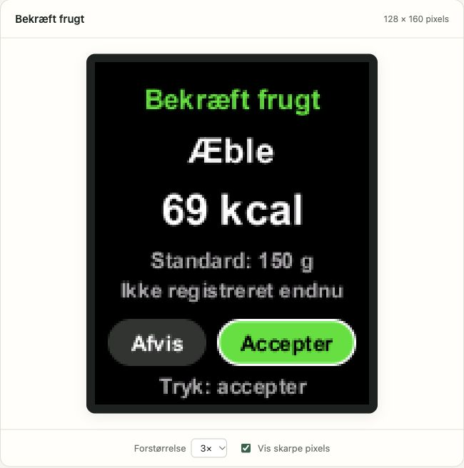

# Fruits & Calories

Prototype til genkendelse af **æble og banan** og registrering af kalorier efter
brugerens bekræftelse. Den rigtige Edge Impulse-model kan nu testes med eget
kamera eller fotos på **localhost uden tilsluttet ESP32 eller skærm**.

Den planlagte hardware er ét **ESP32-WROOM-32-kort**, en **128 × 160-skærm uden touch**
og **én fysisk sideknap**. Betjeningen med én sideknap er foreløbig et separat
designudkast og er endnu ikke implementeret i koden her.

## Aktuel status

| Del | Status |
| --- | --- |
| Foto og kamera på localhost | Implementeret. Kameraet kan åbnes, og egne fotos kan vælges. |
| Billedgenkendelse på computeren | Den medfølgende RGB-model 1.0.8 kører lokalt. Både æble og banan er afprøvet med egne kamerabilleder. |
| Afvis / Accepter | Implementeret. En scanning er et forslag, indtil den accepteres. |
| Design og navigation med én sideknap | Separat designudkast; endnu ikke indarbejdet i preview eller firmware. |
| Samlet ESP32-firmware | Kompileret med modellen, men endnu ikke fysisk afprøvet. Inputkoden bruger fortsat den tidligere touchslider med fem felter og skal tilpasses sideknappen. |

## Test med dit eget kamera eller foto på localhost

### Start previewet

Fra repositoryets rodmappe:

```sh
cd KalorieApp
python3 preview/server.py
```

Åbn **http://127.0.0.1:8000** i Safari eller Chrome. Lad terminalen køre, mens du
tester; stop serveren med **Ctrl+C**. Previewet kræver **Python 3** og en
**C++17-compiler** (`clang++`, `g++` eller `c++`), men ingen ekstra Python-pakker
eller installation af Arduino-biblioteker.

Første opstart bygger den medfølgende **Edge Impulse RGB-model 1.0.8** fra
`models/`-zippen. Vent på **Modellen er klar**; første bygning kan tage et par minutter.
Senere opstarter genbruger den lokale cache i `.preview-cache/`, som Git ignorerer.

Hvis port 8000 er optaget:

```sh
python3 preview/server.py --port 8001
```

Åbn derefter **http://127.0.0.1:8001**. Brug Python-serveren til previewet;
Live Server alene kan ikke køre C++-modellen.

### Scan og bekræft

1. Under **Scan en rigtig frugt** vælger du enten:
   - **Åbn kamera → tillad kameraadgang → Tag billede og scan**, eller
   - et eksisterende foto og derefter **Scan foto**.
2. Hold ét æble eller én banan midt i billedet. Det kvadratiske udsnit beskæres
   og skaleres til **96 × 96 RGB-pixels** og behandles af modellen på computeren.
3. Kontrollér **frugttype, beregnede kcal og standardportion i gram** på den
   virtuelle skærm. **Vis modellens vurdering** viser scores for alle tre klasser.
4. **Afvis er valgt fra start.** Brug **↓** eller knappen **Ned** for at markere
   **Accepter**, og bekræft med **Enter** eller **Tryk**.
5. Først ved accept opdateres dagens kalorier, ugens total og ringen.

**Enter/Tryk direkte efter scanningen afviser** standardvalget. **Escape/Tilbage**
afviser også. Et ventende forslag skal afsluttes, før et nyt billede kan scannes.
Baggrund, ukendte klasser og resultater under 60 % giver intet registrerbart forslag.

Kameraet lukkes med **Luk kamera**. Fotos behandles i hukommelsen og gemmes ikke
af serveren eller sendes til en skytjeneste. Kalorier og indstillinger i localhost-testen
er testdata i hukommelsen og overføres ikke til ESP32. En genstart af serveren
eller knappen **Genstart med startværdier** nulstiller testdata.

Knapperne under **Simulerede testdata** leverer faste testresultater til layouttests.
**Foto- og kamerafunktionen kører den rigtige model.**
Se [PREVIEW.md](KalorieApp/PREVIEW.md) for hot reload og fejlfinding.



## Designudkast med én fysisk sideknap

Skærmen skal vise information og det markerede valg; betjeningen skal ske med
sideknappen. Det separate udkast foreslår:

- **Kort tryk:** Flyt til næste punkt.
- **Hold i cirka 0,8 sekund:** Vælg eller bekræft det markerede punkt.
- **Tilbage / Fortryd:** Synlige valgmuligheder i menuerne.
- **Afvis / Accepter:** Afvis er standard; Accepter kræver markering og et langt tryk.

Dette er **foreslået betjening**. Det nuværende localhost-preview bruger stadig
**Op, Ned, Tryk og Tilbage**, og firmwarekoden indeholder stadig den tidligere
sliderstyring. Hverken skærmens viste knapper eller ordet touchslider betyder,
at den fysiske skærm har touch.

## ESP32-version og byggeopsætning

ESP32-programmet samler skærm, billedmodtagelse via Wi-Fi, Edge Impulse og
bekræftelsesflowet. **Input og navigation skal først tilpasses jeres ene sideknap.**
Den nuværende inputkode forventer fem kapacitive touchfelter fra en tidligere
prototype; det er særskilte inputfelter, ikke berøring på skærmen.

Den samlede version er kompileret med følgende opsætning:

1. **esp32 by Espressif Systems 3.3.12** samt **Adafruit GFX**,
   **Adafruit ST7735 and ST7789** og **Adafruit BusIO**.
2. Installer **[RGB-model 1.0.8](models/ei-image-classification-(fruits)-arduino-1.0.8-impulse-3.zip)**
   via **Sketch → Include Library → Add .ZIP Library…** i Arduino IDE.
   Den gamle modelzip i repositoryets rod bruges ikke af det samlede program.
3. Åbn **[KalorieApp/KalorieApp.ino](KalorieApp/KalorieApp.ino)**, og behold alle
   `.h`-filer i mappen.
4. Vælg **ESP32 Dev Module**, **Flash Size: 4MB (32Mb)** og
   **Partition Scheme: Huge APP (3MB No OTA/1MB SPIFFS)** til et kort med 4 MB flash.
   Standardens 1,3 MB programpartition er for lille til modellen og Wi-Fi sammen med appen.
5. Kompilér med **Verify**. Upload og afprøvning på jeres fysiske opstilling udestår.

Ved senere hardwaretest sender telefonen billeder til ESP32 via netværket
**FruitClassifier**, kode **fruit1234**, og siden **http://192.168.4.1**.
Modellen kører da på ESP32, og resultatet skal bekræftes på enhedens skærm med
betjeningsknappen. Det lokale Wi-Fi kræver ikke internet.

[LAES_MIG.md](KalorieApp/LAES_MIG.md) beskriver den tidligere opstilling med skærm
og touchslider. Dens inputvejledning skal opdateres ved implementering af sideknappen.

## Standardportioner

| Modelklasse | Standardportion, spiselig del | kcal pr. 100 g | Beregnede kcal |
| --- | ---: | ---: | ---: |
| Æble | 150 g | 46 | 69 |
| Banan | 120 g | 88 | 106 |

Portionsstørrelserne er **faste prototypevalg** og bliver ikke målt af kameraet.
Bananvægten er uden skræl; æblevægten er den del, der spises. Kcal afrundes til hele tal.
Værdier og portionsstørrelser kan ændres i
[frugt_kalorier.h](KalorieApp/frugt_kalorier.h).
Energikilder: Mattilsynets Matvaretabellen for
[æble](https://www.matvaretabellen.no/eple-uspesifisert-ra/) og
[banan](https://www.matvaretabellen.no/en/banana-raw/), tilgået 17. november 2026.

## Kode og model

| Mappe / fil | Rolle |
| --- | --- |
| `KalorieApp/KalorieApp.ino` | ESP32-program med skærm, tidligere sliderinput, Wi-Fi, model og bekræftelse |
| `KalorieApp/preview/` | Localhost-server, kamera/foto, lokal modelkørsel og virtuel skærm |
| `KalorieApp/preview/native_classifier.py` | Bygger og kører modelbiblioteket på computeren |
| `KalorieApp/frugt_scanner.h` | ESP32-billedmodtagelse og kald til Edge Impulse |
| `KalorieApp/frugt_kalorier.h` | Klasser, portioner, energi og sikkerhedsgrænse |
| `KalorieApp/app_model.h` | Midlertidigt forslag og registrering efter accept |
| `KalorieApp/telefon_side.h` | Telefonens foto- og scanningsside til ESP32 |
| `models/` | RGB-model 1.0.8 fra branch `Classifier-with-RGB` |
| `Edge_impulse_WIP/` | Tidligere selvstændig prototype, bevaret som reference |
| `tests/` | Tests af bekræftelse, RGB-data, hot reload og rigtig lokal inferens |

På ESP32 bruger billedet midlertidigt skærmbufferens 40 KB; der tegnes ikke samtidigt.
Animationsbufferen allokeres kun under sideskift og frigives før scanning.
Den eksisterende slider-sampling fortsætter, men skærm/navigation venter under
upload og inferens. Events fra ventetiden kasseres, før bekræftelsessiden betjenes.

## Verifikation og næste trin

Softwareflowet og RGB-bufferen er testet med address/undefined-sanitizer.
Previewets hot reload, rigtig lokal modelkørsel og foto → Banan → Accepter er afprøvet.
Kameragenkendelse af både æble og banan er desuden afprøvet med egne billeder.
ESP32-programmet er kompileret med Arduino-ESP32 3.3.12 og Huge APP.

Næste trin er at implementere input fra én sideknap og det tilhørende design i
preview og firmware og derefter afprøve den samlede løsning på kortet.
**Der er endnu ikke foretaget fysisk test af den samlede ESP32-version.**
Modelkørsel, fri RAM, knapbetjening under Wi-Fi og gentagne fotos skal kontrolleres
på udstyret. Serial Monitor (115200 baud) viser modelresultater, fejlkoder,
fri heap og største ledige hukommelsesblok. En modelfejl giver ingen registrering.
Dato og automatisk dag-/ugeskift er fortsat ikke tilkoblet.

Kør softwaretests som beskrevet i [tests/README.md](tests/README.md).
`KalorieApp/KONTROL.txt` er historiske testresultater fra versionen før integrationen.
